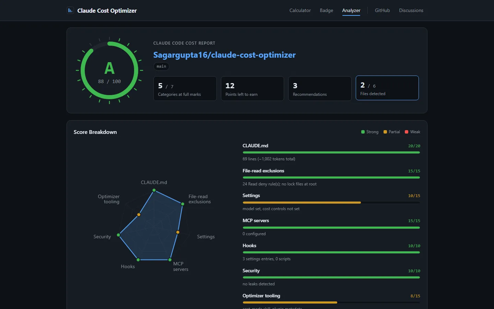
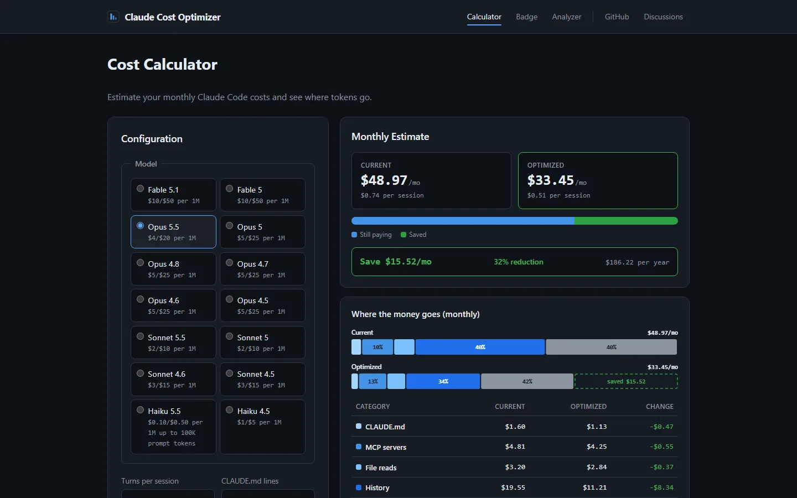
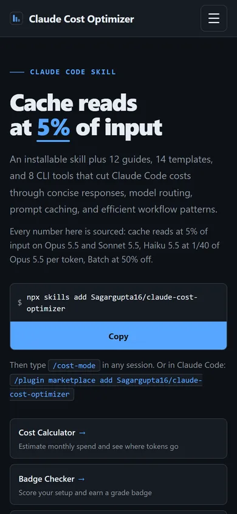
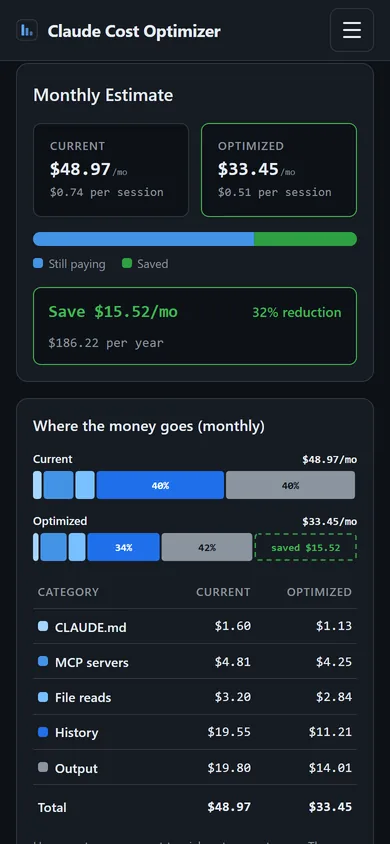
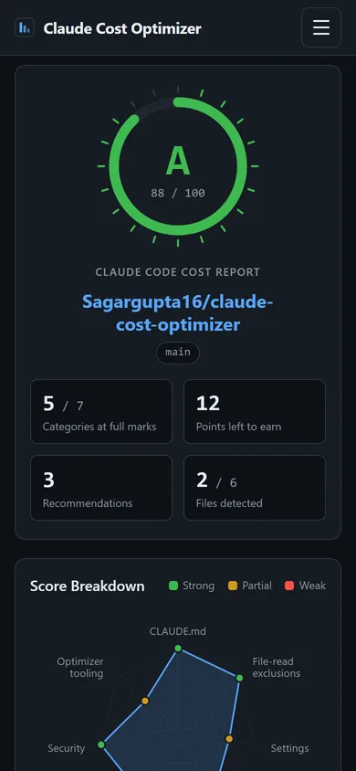
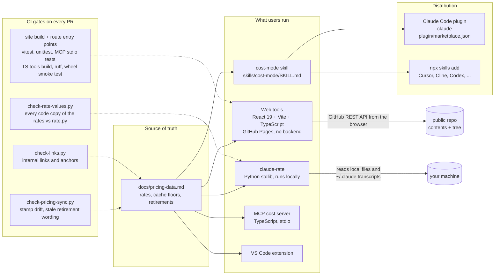

<p align="center"></p>

# Claude Cost Optimizer


> **Cut Claude Code costs with sourced levers**: cache reads bill at 5% of input on Opus 5.5 and Sonnet 5.5, Haiku 5.5 costs 1/40 of Opus 5.5 per token (prompts up to 100K tokens), and Batch is 50% off ([Anthropic pricing](https://platform.claude.com/docs/en/about-claude/pricing)) -- with an installable skill, CLI tools, and 12 deep-dive guides.
>
> **No one has published a typical saving for a mixed Claude Code workload, so this repo does not quote one.** What is measured: prompt caching cut agent-loop cost 2.7x to 5.3x on [Anthropic's benchmarks](https://platform.claude.com/docs/en/about-claude/models/optimizing-for-cost-and-intelligence), and Anthropic's [cost-optimization cookbook](https://platform.claude.com/cookbook/cost-optimization-cost-optimization) stacked model choice, effort and caching on one agent for a 13x lower cost per task ($0.2906 to $0.0223, 10/10 tasks passed both ways). See [How far can you actually go?](#how-far-can-you-actually-go), and price your own sessions with `/usage` or [claude-rate](#rate-your-setup).

**Live site:** [sagargupta.online/claude-cost-optimizer](https://sagargupta.online/claude-cost-optimizer/) -- [Repo Analyzer](https://sagargupta.online/claude-cost-optimizer/analyzer/) | [Cost Calculator](https://sagargupta.online/claude-cost-optimizer/calculator/) | [Badge Checker](https://sagargupta.online/claude-cost-optimizer/badge/). How the pieces fit: [How It Is Built](#how-it-is-built).

<table>
  <tr>
    <td width="50%"><a href="https://sagargupta.online/claude-cost-optimizer/analyzer/"></a></td>
    <td width="50%"><a href="https://sagargupta.online/claude-cost-optimizer/calculator/"></a></td>
  </tr>
  <tr>
    <td align="center"><b>Repo Analyzer</b>: paste a public repo, get a grade and the fixes</td>
    <td align="center"><b>Cost Calculator</b>: cache-aware monthly spend and where it goes</td>
  </tr>
</table>

<p align="center">
  
  
  
</p>

Screenshots come from `scripts/capture-screenshots.py` (Playwright against a local build, 1440x900 and 390x844), which also renders the site's 1200x630 social preview image.

## Install

**Claude Code (official plugin system):**

```bash
/plugin marketplace add Sagargupta16/claude-cost-optimizer
/plugin install cost-mode@claude-cost-optimizer
```

**Multi-agent (Cursor, Cline, Codex, 40+ agents):**

```bash
npx skills add Sagargupta16/claude-cost-optimizer
```

Then activate in any session:

```
/cost-mode              # Standard: concise fragments OK
/cost-mode lite         # Professional brevity, full sentences
/cost-mode strict       # Telegraphic, max brevity
/cost-mode off          # Resume normal behavior
```

---

## What cost-mode Does

| Feature | How It Saves Tokens |
|---------|-------------------|
| **Strips filler** | Drops pleasantries, hedging, restating your question, trailing summaries |
| **Suggests cheaper models** | "Haiku handles this -- `/model haiku`" for simple tasks |
| **Suggests CLI tools** | "Use `prettier`/`eslint --fix` directly" instead of burning LLM tokens |
| **Session awareness** | Reminds to `/compact` after 20+ turns, fresh sessions for new tasks |
| **Minimal code gen** | Diffs over rewrites, no obvious comments, no speculative error handling |
| **Auto-deactivates** | Full clarity for security warnings, destructive ops, and when you're confused |

Technical accuracy is never sacrificed. Code in commits and PRs is written normally.

[Full skill documentation](skills/cost-mode/README.md)

---

## Rate your setup

### Locally, one command (recommended)

`claude-rate` runs on your filesystem -- no signup, no install, no GitHub upload. The only requirement is Python 3.10 or later (preinstalled on most Linux distributions; on macOS it comes with the Xcode Command Line Tools). The command streams the script straight into Python, so nothing is installed or written to disk. Run it in your project directory:

Windows PowerShell:

```powershell
irm https://raw.githubusercontent.com/Sagargupta16/claude-cost-optimizer/main/tools/claude-rate/rate.py | python - . --user --usage --fix
```

macOS, Linux, Git Bash, or Windows cmd (on Windows, `python` instead of `python3`):

```bash
curl -sSL https://raw.githubusercontent.com/Sagargupta16/claude-cost-optimizer/main/tools/claude-rate/rate.py | python3 - . --user --usage --fix
```

It grades the project, your user-level setup in `~/.claude` and your last 30 days of Claude Code usage, then prints the fixes. Drop `--user --usage` to grade only the project. To keep a `claude-rate` command on macOS or Linux, run `curl -sSL https://raw.githubusercontent.com/Sagargupta16/claude-cost-optimizer/main/tools/claude-rate/install.sh | sh -s -- --install`.

`--fix` prints copy-pasteable fix commands; add `--strict` to fail CI when the grade drops below B, or `--json` for machine-readable output. See [tools/claude-rate/README.md](tools/claude-rate/README.md) for the full breakdown.

`--user` and `--usage` grade your user-level setup -- global instructions, skill listing, user MCP servers, user settings -- and your measured usage from local Claude Code transcripts: cache hit rate, context size, and list-price spend per model (last 30 days by default). All of it is read locally; nothing leaves your machine.

The local rater works on private and uncommitted repos and inspects things the web analyzer can't reach: `settings.local.json`, whether your `Read(...)` deny rules cover the lock files actually on disk, and secrets in your working tree. The [web analyzer](https://sagargupta16.github.io/claude-cost-optimizer/analyzer) applies the same 7-category rubric (CLAUDE.md, file-read exclusions, settings, MCP, hooks, security, skills/agents/commands) to any public repo.

### Public repos -- web tools

| Tool | What It Does |
|------|-------------|
| **[Repo Analyzer](https://sagargupta16.github.io/claude-cost-optimizer/analyzer)** | Paste a GitHub URL to get a cost audit, grade (A+ to F), and recommendations |
| **[Cost Calculator](https://sagargupta16.github.io/claude-cost-optimizer/calculator)** | Estimate monthly spend with interactive charts: per-turn cost curve, savings breakdown, model comparison |
| **[Badge Checker](https://sagargupta16.github.io/claude-cost-optimizer/badge)** | Score your setup and get a shields.io badge for your repo |

---

## How It Is Built

One pricing reference feeds every surface: the skill, the web tools, the CLI graders, the MCP server and the VS Code extension. Each carries its own copy of the rates, because each has to run on its own (claude-rate streams into `python -` with no install). CI fails a pull request when any rate value in the six code copies (344 values on 2026-10-18) disagrees with `rate.py`, when a file's verified-date stamp disagrees with the canonical one, or when a file still calls a passed retirement date upcoming. Each implementation of the cost math has a test suite pinned to the worked example below.



| Decision | Why |
|----------|-----|
| **Web tools run entirely in the browser** | The Repo Analyzer calls the GitHub REST API directly, so there is no server to host and no token to store; repo data comes from `api.github.com` and the grade badge from `img.shields.io`. The cost is GitHub's unauthenticated rate limit. |
| **claude-rate is one stdlib Python file** | It streams into `python -` from `curl` or `irm` with no install step, and it can read what the web tool cannot: `settings.local.json`, lock files on disk, and your local Claude Code transcripts for real cache hit rate and spend. |
| **Session math is cache-aware** | Every estimator bills a turn the way Claude Code caches a conversation: turn 1 writes the whole prompt, every later turn reads the previous request and writes only the new exchange. The old flat-hit-rate model overstated a 30-turn Opus 5.5 session about 4.6x (see [CHANGELOG 1.16.0](CHANGELOG.md#1160---2026-10-11)). |
| **Every saving needs a source or a formula** | The repo's product is being a trustworthy pricing reference, so a claim without a link or a computed formula is treated as a bug, and `check-pricing-sync.py` turns the drift failures that shipped before into CI errors. |
| **Each tool route gets a real `index.html`** | GitHub Pages would otherwise answer `/calculator` with HTTP 404 behind the SPA fallback; `site/scripts/spa-404.mjs` writes one per route with its own canonical URL so search engines index each tool. |

Run it locally:

```bash
# repo gates CI runs, from the repo root
python scripts/check-pricing-sync.py .
python scripts/check-rate-values.py .
python scripts/check-links.py .
python -m unittest discover -s tools/claude-rate/tests
python tools/claude-rate/rate.py . --json

# web tools (Node 24)
cd site
npm ci --legacy-peer-deps
npm test
npm run dev
```

---

## Before vs After

Worked example: a 30-turn session on Opus 5.5 ($4/$20 per 1M; 5-minute cache writes $5, cache reads $0.20), one 2,000-token file read, about 1,500 tokens of new conversation and 500 output tokens per turn. It is billed the way Claude Code caches a conversation ([prompt caching docs](https://code.claude.com/docs/en/prompt-caching)): turn 1 writes the whole prompt to the cache, and every later turn reads the previous request back and writes only the new exchange. The figures are arithmetic from the posted rates (the same model as the [calculator](https://sagargupta16.github.io/claude-cost-optimizer/calculator)), not a metered bill. The MCP share assumes tool search is off (full schemas up front); with the default tool search on, the "before" prefix is smaller to start with:

```
BEFORE (no optimization):                 AFTER (5 minutes of setup):
  CLAUDE.md:        6,200 chars             CLAUDE.md:        2,800 chars
  Read deny rules:  none                    Read deny rules:  12 patterns
  MCP servers:      6 active                MCP servers:      2 active
  Prefix:           ~15,000 tokens          Prefix:           ~5,500 tokens
  Session cost:     $0.82                   Session cost:     $0.72
  Monthly (3x/day): $54.31                  Monthly (3x/day): $47.54

  Savings: $6.77/month (12%)
```

The setup cleanup saves 12%, not more, because the prefix is a cache read on 29 of the 30 turns. Output is the bigger share: 500 tokens a turn is $0.30 of the $0.82 (36%), so halving output saves $0.15 a session, more than the whole cleanup. Without caching the same session would cost $4.95, and the cleanup would save 23%. The Read deny rules are not in these figures: what they save depends on which files your sessions would otherwise read.

---

## How Far Can You Actually Go?

Short answer: **there is no published typical figure for a whole Claude Code workload.** Each lever below is measured or priced by Anthropic, and each applies only to its own slice of spend. The one stacked measurement Anthropic has published is its [cookbook agent](https://platform.claude.com/cookbook/cost-optimization-cost-optimization): moving from Opus 5 at high effort to Sonnet 5 at medium with explicit cache breakpoints cut cost per task 13x ($0.2906 to $0.0223) at the same 10/10 pass rate.

| Lever | Published savings | Applies to | Source |
|-------|:-----------------:|------------|--------|
| **Prompt caching** | **up to 90%** cost (**95%** on Opus 5.5 and Sonnet 5.5, **97.5%** on Fable 5.1), 85% latency; agent-loop cost cut 2.7x to 5.3x on Anthropic's benchmarks | cached input only (0.1x input price; 0.05x on Opus 5.5 / Sonnet 5.5; 0.025x on Fable 5.1 / Mythos 5.1) | [Anthropic: Prompt caching](https://claude.com/blog/prompt-caching), [pricing docs](https://platform.claude.com/docs/en/about-claude/pricing), [cost and intelligence guide](https://platform.claude.com/docs/en/about-claude/models/optimizing-for-cost-and-intelligence) |
| **Batch API** | flat **50%** off input **and** output, stacks with caching | any async (24h) work | [Anthropic: Message Batches API](https://claude.com/blog/message-batches-api), [batch docs](https://platform.claude.com/docs/en/build-with-claude/batch-processing) |
| **Model routing** | **up to 97.5%** per token (Opus 5.5->Haiku 5.5 is 40x at <=100K prompt tokens, 8x above; legacy Haiku 4.5 was 4x); measured per answer, Haiku 5.5 cost about 1/20 of Opus 5.5 per GPQA Diamond question at 85% vs 91% accuracy; RouteLLM cut cost over 85% on MT Bench (45% on MMLU, 35% on GSM8K) at 95% of GPT-4's performance | tasks a cheaper model handles well | [cost and intelligence guide](https://platform.claude.com/docs/en/about-claude/models/optimizing-for-cost-and-intelligence), [RouteLLM (arXiv 2406.18665)](https://arxiv.org/pdf/2406.18665), [LMSYS](https://lmsys.org/blog/2024-07-01-routellm/) |
| **Context management** | **84%** fewer tokens in a 100-turn eval | long agentic sessions | [Anthropic: Context management](https://claude.com/blog/context-management) |
| **Subscription vs API** | **~95%** for one heavy user (n=1): over $15,000 of API-equivalent usage for about $800 of Max subscription (author's tracker, post dated 2026-02-23; computed: 1 - 800 / 15,000 = 94.7%). Plans are Pro $20 / Max $100-200 flat; Max's $100-200/mo of API credits do not cover Claude Code | power users vs pay-as-you-go | [ksred cost tracker](https://www.ksred.com/claude-code-pricing-guide-which-plan-actually-saves-you-money/) (n=1) |

### The honest read

- **Each lever's number applies to its own slice.** Cache-read pricing applies to cached input only. The 40x routing ratio applies only to tasks Haiku 5.5 completes: Anthropic measured Haiku 5.5 at about 1/20 of Opus 5.5's cost per GPQA Diamond question, at 85% accuracy vs 91% ([cost and intelligence guide](https://platform.claude.com/docs/en/about-claude/models/optimizing-for-cost-and-intelligence)). The only stacked measurement is the [cookbook's](https://platform.claude.com/cookbook/cost-optimization-cost-optimization) 13x on one agent.
- **The stacked total has no source.** Each lever above is individually sourced; the combined figure is not, and this repo holds no controlled multi-lever measurement. For a number that applies to your workload, run [claude-rate](#rate-your-setup) on your own repo and price only the levers you can apply.
- **The cost-mode skill has not been benchmarked.** It trims visible output and suggests model routing. Its effect on cost is the output cut times the output share of your spend: in the token mix of Anthropic's own [/usage example](https://code.claude.com/docs/en/costs), priced at Opus 5.5 rates, output is 19% of the bill, so a 40% output cut saves about 8% (computed: 0.40 x 19.3%). Thinking bills as output and brevity rules do not shrink it; `/effort` does.
- **Caching and batch are the firmest floors** (first-party Anthropic pricing; batch is a documented flat 50% that provably stacks with caching). Routing and subscription savings are the most workload-sensitive.

> Prices verified against the [pricing reference](#pricing-reference) below (2026-10-09). Cache hit = 0.1x base input on every model **except Fable 5.1 and Mythos 5.1 (0.025x) and Opus 5.5 and Sonnet 5.5 (0.05x)**; Batch = 50% off both input and output.

---

## Quick Start (5 Minutes, No Skill Needed)

Even without installing the skill, these 5 changes cut costs immediately:

| # | Strategy | Savings | Guide |
|---|----------|:-------:|-------|
| 1 | **Keep CLAUDE.md under 200 lines** -- it loads in full every session; Anthropic's guidance is that longer files "consume more context and reduce adherence". Move workflow-specific instructions into skills or path-scoped `.claude/rules/` | No published figure | [Context Optimization](guides/02-context-optimization.md) |
| 2 | **Use Haiku for simple tasks** (`--model haiku`) -- Haiku 5.5 is $0.10/$0.50 up to 100K prompt tokens, $0.50/$2.50 above: 40x cheaper per token than Opus 5.5 below 100K, 8x above | 1/40 of Opus 5.5 per moved task (per token) | [Model Selection](guides/03-model-selection.md) |
| 3 | **Use Plan Mode before coding** (Shift+Tab) -- prevents wasted iterative cycles | No published figure | [Workflow Patterns](guides/04-workflow-patterns.md) |
| 4 | **Add `Read(...)` deny rules** to `permissions.deny` in `.claude/settings.json` -- keep Claude's file tools out of node_modules, dist, lock files (`.claudeignore` is not a Claude Code feature) | No published figure | [Context Optimization](guides/02-context-optimization.md) |
| 5 | **Delegate to subagents** -- isolate expensive searches from main context | No Claude Code figure; [cookbook](https://platform.claude.com/cookbook/cost-optimization-cost-optimization) subagent pattern: 78% cheaper on one agent loop | [Workflow Patterns](guides/04-workflow-patterns.md) |

Full walkthrough: **[Getting Started in 5 Minutes](guides/00-getting-started.md)**

---

## Skills Roadmap

cost-mode is the first skill. More are planned:

| Skill | Status | What It Does | Cost Impact |
|-------|:------:|-------------|:-----------:|
| **cost-mode** | Live | Concise responses, model routing suggestions, session awareness | Not benchmarked ([Anthropic](https://platform.claude.com/docs/en/about-claude/models/optimizing-for-cost-and-intelligence): asking for shorter answers cut output tokens 39%, cost 14%) |
| **deny-rules-gen** | Planned | Generates `permissions.deny` `Read(...)` rules for your project's tech stack | No published figure |
| **context-compress** | Planned | Rewrites your CLAUDE.md to be shorter while keeping all essential info | About 5% of a 30-turn session for 500 to 150 lines (computed with this repo's cache-aware calculator at 10 tokens per line: $0.7851 to $0.7473 on Opus 5.5), plus adherence |
| **cache-optimizer** | Planned | Detects cache-busting patterns and suggests fixes to maximize prompt cache hits | [Anthropic](https://platform.claude.com/docs/en/about-claude/models/optimizing-for-cost-and-intelligence): one cache-busting 25-token prefix made a run 7.2x dearer ($4.24 vs $0.59) |
| **budget-guard** | Planned | Per-session and per-day spending limits with warnings before you blow past them | Prevents overspend |

Want to build one? Skills are just `SKILL.md` files -- see [CONTRIBUTING.md](CONTRIBUTING.md) and the [skills/cost-mode/](skills/cost-mode/) directory for the pattern.

---

## Guides

12 deep-dive guides covering every optimization area:

| Guide | What You'll Learn |
|-------|-------------------|
| [00 - Getting Started](guides/00-getting-started.md) | Zero to optimized in 5 minutes -- the essential setup |
| [01 - Understanding Costs](guides/01-understanding-costs.md) | How billing works, what costs the most, where money goes |
| [02 - Context Optimization](guides/02-context-optimization.md) | Reduce input tokens: CLAUDE.md, Read deny rules, file reads |
| [03 - Model Selection](guides/03-model-selection.md) | When to use Opus vs Sonnet vs Haiku (with decision tree) |
| [04 - Workflow Patterns](guides/04-workflow-patterns.md) | Plan mode, subagents, commands, batch operations |
| [05 - Team Budgeting](guides/05-team-budgeting.md) | Per-developer budgets, cost tracking, ROI calculation |
| [06 - Access Methods & Pricing](guides/06-access-methods-pricing.md) | Compare API vs Bedrock vs Vertex AI vs Claude Code pricing |
| [07 - MCP & Agent Cost Impact](guides/07-mcp-agent-costs.md) | MCP server overhead, subagent costs, Agent SDK patterns |
| [08 - Prompt Caching Deep Dive](guides/08-prompt-caching.md) | Cache mechanics, TTL economics, maximizing hit rates, ROI math |
| [09 - Subscription Plan Value](guides/09-subscription-value.md) | Choose the right plan, maximize allowance, upgrade/downgrade signals |
| [10 - Three-Tier Task Routing](guides/10-task-routing.md) | Skip the LLM for Tier 0 tasks, route cheap tasks to Haiku, save Opus for complex work |
| [11 - Speed vs Cost](guides/11-speed-vs-cost.md) | Make Claude faster without burning money -- free latency levers first, Fast Mode economics last |

Also: [Visual Diagrams](guides/diagrams.md) (Mermaid flowcharts) | [One-Page Cheatsheet](cheatsheet.md)

---

## Templates

Copy-paste configs that are already optimized:

**CLAUDE.md**: [Minimal](templates/CLAUDE.md/minimal.md) | [Standard](templates/CLAUDE.md/standard.md) | [Comprehensive](templates/CLAUDE.md/comprehensive.md) | [Monorepo](templates/CLAUDE.md/monorepo.md)

**By Stack**: [React+Vite](templates/CLAUDE.md/by-stack/react-vite.md) | [Next.js](templates/CLAUDE.md/by-stack/nextjs.md) | [FastAPI](templates/CLAUDE.md/by-stack/fastapi-python.md) | [MERN](templates/CLAUDE.md/by-stack/mern.md) | [Terraform](templates/CLAUDE.md/by-stack/terraform-aws.md) | [Go](templates/CLAUDE.md/by-stack/go.md) | [Rust](templates/CLAUDE.md/by-stack/rust.md) | [Django](templates/CLAUDE.md/by-stack/django.md) | [Rails](templates/CLAUDE.md/by-stack/rails.md) | [Spring Boot](templates/CLAUDE.md/by-stack/java-spring.md)

**Settings**: [Cost-Conscious](templates/settings/cost-conscious.json) | [Balanced](templates/settings/balanced.json) | [Performance-First](templates/settings/performance-first.json)

**Commands**: [/cost-check](templates/commands/cost-check.md) | [/budget-mode](templates/commands/budget-mode.md) | [/quick-fix](templates/commands/quick-fix.md) | [/optimize](tools/optimize-command/optimize.md)

---

## CLI Tools

The 8 tools in `tools/`, plus the budget hooks in `hooks/`. [Full tools documentation](tools/README.md)

| Tool | What It Does |
|------|-------------|
| [claude-rate](tools/claude-rate/) | Grade your local setup on the 7-category rubric (recommended entry point) |
| [Token Estimator](tools/token-estimator/) | Estimate token count and cost for any file |
| [Usage Analyzer](tools/usage-analyzer/) | Find cost hotspots across your sessions |
| [Badge Generator](tools/badge-generator/) | Grade your project config (A+ to F) from the CLI |
| [MCP Cost Server](tools/mcp-cost-server/) | In-session cost estimation via MCP |
| [VS Code Extension](tools/vscode-extension/) | Token count and cost in the status bar |
| [GitHub Action](tools/actions/claude-cost-audit/) | Automated cost audit on PRs |
| [/optimize Command](tools/optimize-command/) | Claude Code custom command that audits the current project |
| [Budget Hooks](hooks/) | Track tool calls, log costs, warn at thresholds |

---

## Pricing Reference

Current models, per 1M tokens, verified 2026-10-09 against Anthropic's [pricing page](https://platform.claude.com/docs/en/about-claude/pricing). Legacy snapshots, Batch and Fast Mode rates, subscriptions, the `sonnet`/`haiku` alias gotcha, migration notes for Opus 5.5, Sonnet 5.5, Haiku 5.5 and Opus 5, and retired models are in **[docs/pricing-reference.md](docs/pricing-reference.md)**.

| Model | Input | Output | Cache hit | 5m cache write | Min cacheable prompt |
|-------|:-----:|:------:|:---------:|:--------------:|:--------------------:|
| **Fable 5.1** (highest capability) | $10.00 | $50.00 | $0.25 | $12.50 | 512 |
| **Opus 5.5** (recommended default) | $4.00 | $20.00 | $0.20 | $5.00 | 512 |
| **Sonnet 5.5** | $2.00 | $10.00 | $0.10 | $2.50 | 512 |
| **Haiku 5.5** (prompt <= 100K tokens) | $0.10 | $0.50 | $0.01 | $0.125 | 512 |
| Haiku 5.5 (prompt > 100K tokens, whole request) | $0.50 | $2.50 | $0.05 | $0.625 | 512 |

Batch is 50% off input and output and stacks with caching. A prompt under the minimum cacheable length is silently not cached.

---

## Benchmarks & Case Studies

- [Task Comparison](benchmarks/task-comparison.md) -- same task, optimized vs not
- [Model Comparison](benchmarks/model-comparison.md) -- Opus vs Sonnet vs Haiku
- [Context Size Impact](benchmarks/context-size-impact.md) -- how CLAUDE.md size affects cost
- [Community Leaderboard](benchmarks/leaderboard.md) -- crowdsourced cost-per-task data
- [Case Studies](case-studies/README.md) -- submission template and format; no stories published yet, contributions welcome

---

## Community

- **[GitHub Discussions](https://github.com/Sagargupta16/claude-cost-optimizer/discussions)** -- ask questions, share strategies
- **[Contributing](CONTRIBUTING.md)** -- from starring the repo to building new skills
- **[Issue Templates](https://github.com/Sagargupta16/claude-cost-optimizer/issues/new/choose)** -- tips, benchmarks, case studies

### Complementary Projects

Stars read on GitHub 2026-09-28. The savings column is each project's **own claim**, not something this repo has measured; `--` means the project publishes no savings figure.

| Project | Stars | What It Does | Savings (project's own claim) |
|---------|:-----:|-------------|:-------:|
| [caveman](https://github.com/JuliusBrussee/caveman) | 108k | Brevity skill plus proxy -- strips filler from responses | Claims "cuts 65% of tokens" |
| [claude-mem](https://github.com/thedotmack/claude-mem) | 95k | Persistent compressed context across sessions | -- |
| [rtk](https://github.com/rtk-ai/rtk) | 82k | CLI proxy that compresses common dev-command output before Claude reads it | Claims "60-90%" on common dev commands; its README adds this "is not the same as cutting your bill by 90%" |
| [claude-code-router](https://github.com/musistudio/claude-code-router) | 37k | Routes Claude Code requests across models | -- |
| [ccusage](https://github.com/ccusage/ccusage) | 18.7k | `npx ccusage` usage and cost reports from your local logs | -- |
| [Claude-Code-Usage-Monitor](https://github.com/Maciek-roboblog/Claude-Code-Usage-Monitor) | 8.7k | Real-time usage monitor with predictions | -- |
| [claudetop](https://github.com/liorwn/claudetop) | 212 | htop-style cost and cache monitor | -- |

---

## FAQ

<details>
<summary>How much does Claude Code actually cost?</summary>

With Pro ($20/mo or $200/yr ≈ $16.67/mo with annual billing -- 17% off), Max 5x ($100/mo), or Max 20x ($200/mo), you get included usage. For enterprise deployments, Anthropic's own average is about **$13 per developer per active day** and **$150-250 per developer per month**, with 90% of users under $30 per active day ([Claude Code costs docs](https://code.claude.com/docs/en/costs)); run `/usage` in Claude Code to see your own session cost. Opus 5, 4.8, 4.7, and 4.6 at $5/$25 are 3x cheaper per token than Opus 4.1 ($15/$75), and Opus 5.5 at $4/$20 is cheaper still -- but the tokenizer introduced with Opus 4.7 (shared by Opus 5.5) produces about 30% more tokens for the same text ([Anthropic's pricing page](https://platform.claude.com/docs/en/about-claude/pricing)), so per task the gap for the $5/$25 models is about 2.3x (computed: 3 / 1.3).
</details>

<details>
<summary>Does this apply to the Claude API too?</summary>

Context optimization, model selection, and prompt engineering apply to both. The skill and commands are Claude Code-specific.
</details>

<details>
<summary>Will optimization reduce output quality?</summary>

No. These strategies eliminate waste (duplicate context, unnecessary file reads, expensive models for simple tasks). Quality stays the same or improves -- less noise means better reasoning.
</details>

<details>
<summary>What's the biggest single change I can make?</summary>

Switch routine work to Haiku 5.5 (`/model haiku`, or `model: haiku` on subagents): each task you move costs 1/40 of Opus 5.5 per token while prompts stay under 100K tokens ([Anthropic pricing](https://platform.claude.com/docs/en/about-claude/pricing)). If routine work is 30% of your Opus 5.5 spend, that is 29% off the bill (computed: 0.30 x 0.975). Then install cost-mode (`npx skills add Sagargupta16/claude-cost-optimizer`) for shorter answers.
</details>

---

## Star History

If this repo helped you save money, consider giving it a star!

<a href="https://www.star-history.com/?repos=Sagargupta16%2Fclaude-cost-optimizer&type=timeline&legend=bottom-right">
 <picture>
   <source media="(prefers-color-scheme: dark)" srcset="https://api.star-history.com/chart?repos=Sagargupta16/claude-cost-optimizer&type=timeline&theme=dark&legend=bottom-right" />
   <source media="(prefers-color-scheme: light)" srcset="https://api.star-history.com/chart?repos=Sagargupta16/claude-cost-optimizer&type=timeline&legend=bottom-right" />
   
 </picture>
</a>

---

## More AI Developer Tools

If you found this useful, check out my other AI/Claude tools:

| Project | Description |
|---------|-------------|
| [claude-code-recipes](https://github.com/Sagargupta16/claude-code-recipes) | 47 copy-paste recipes for Claude Code - commands, subagents, hooks, skills |
| [claude-skills](https://github.com/Sagargupta16/claude-skills) | Custom Claude Code plugin marketplace with dev-workflow, FARM stack, and more |
| [agent-recipes](https://github.com/Sagargupta16/agent-recipes) | AI agent workflows for real-world dev tasks - code review, testing, security |
| [ai-git-hooks](https://github.com/Sagargupta16/ai-git-hooks) | AI-powered git hooks - auto-review diffs, generate commit messages, security scanning |
| [mcp-toolkit](https://github.com/Sagargupta16/mcp-toolkit) | Production-ready middleware for MCP servers - auth, caching, rate limiting |

---

## License

[MIT](LICENSE) - use these strategies, templates, and tools however you want.
